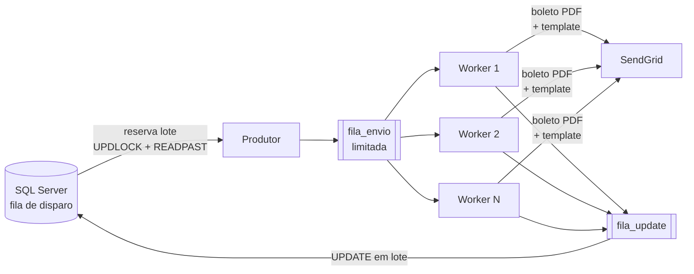

# Motor de Disparo de E-mails

Motor assíncrono em Python para disparo de e-mails transacionais em massa (cobrança, lembretes, boletos) a partir de uma fila no SQL Server, com envio via SendGrid.

> **Em produção, este motor processa mais de 500 mil e-mails por dia.**
> Esta é a versão de portfólio de um sistema que desenvolvi e mantenho. Nomes de banco, tabelas, servidores e dados foram trocados por exemplos genéricos. A lógica e a arquitetura são as mesmas.

---

## O problema

Uma operação de cobrança precisa mandar, todo dia, centenas de milhares de e-mails para vários credores (cedentes). Muitos levam o boleto em PDF anexado. Os requisitos:

- **Nunca mandar o mesmo e-mail duas vezes**, mesmo com dezenas de envios em paralelo ou com duas instâncias do robô rodando.
- **Não perder nada se o processo cair no meio.**
- **Ser rápido**, sem derrubar o banco nem estourar o limite do provedor.
- **Dividir a capacidade entre os credores** de forma justa, priorizando os de maior volume.

## Como funciona



1. **Reset de segurança:** registros presos em `PROCESSANDO` há mais de 30 min (execução anterior que caiu) voltam para `PENDENTE`.
2. **Distribuição de workers:** o total de workers é dividido entre os cedentes pendentes. Todos recebem ao menos 1, e o peso define quem recebe mais.
3. **Um processador por cedente, em paralelo:**
   - o **produtor** reserva lotes no banco de forma atômica (`PENDENTE → PROCESSANDO`);
   - os **workers** baixam o boleto (se houver), montam o template e enviam;
   - uma **tarefa de flush** acumula os resultados e grava no banco em lote.

## Decisões técnicas

| Desafio | Solução |
|---|---|
| Não enviar duplicado com N workers e N instâncias | Reserva atômica num único comando: `UPDATE ... OUTPUT` sobre um `SELECT TOP (n) WITH (UPDLOCK, READPAST, ROWLOCK)`. Quem chega depois **pula** as linhas travadas, em vez de esperar. |
| Não estourar a memória com bases grandes | Filas `asyncio.Queue` com tamanho máximo (**backpressure**): se o envio fica lento, o produtor para de buscar. |
| Bibliotecas bloqueantes (pyodbc, requests) dentro de asyncio | Cada chamada roda via `asyncio.to_thread`, e o pool de threads é dimensionado para o nº de workers, já que o padrão do Python limitaria o paralelismo real. |
| Milhares de conexões com banco e provedor | **Conexão por thread** (thread-local), reaproveitada em todas as queries e requests da thread, com reconexão automática se o link cair. |
| Limite de taxa e instabilidade do provedor | Retry só em erros transitórios (429/5xx/rede), respeitando o `Retry-After`. Erro definitivo (400) não é repetido. |
| Processo cai no meio | Status `PROCESSANDO` funciona como reserva. O reset devolve os presos para `PENDENTE` na próxima execução. |
| Um registro ruim não pode parar o lote | Cada envio devolve um status final (`SUCESSO`, `ERRO`, `ERRO ao baixar boleto`). Um cedente com falha não derruba os outros (`gather(return_exceptions=True)`). |
| Rastrear entregas por credor | `custom_args` (`id_cedente`, `id_template`) vão junto do e-mail e voltam no webhook da SendGrid para a API de monitoramento. |
| Muitos UPDATEs no banco | Os status são gravados em lote, num único `UPDATE ... JOIN (VALUES ...)` por bloco. |

## Arquitetura

Camadas no estilo Clean Architecture. A aplicação depende só de **contratos** (`ports.py`), então o mesmo motor roda com SQL Server + SendGrid em produção ou com memória + provedor falso na demo e nos testes.

```
src/
├── domain/
│   └── status.py                  # estados da fila e canais
├── application/
│   ├── ports.py                   # contratos: repositório, provedor, boleto
│   ├── processors/
│   │   └── cedente_processor.py   # produtor/consumidor de um cedente
│   └── services/
│       ├── envio_service.py       # orquestra o canal inteiro
│       └── boleto_service.py      # baixa o PDF e vira anexo
├── infrastructure/
│   ├── database/sql_server_connection.py   # conexão por thread + reconexão
│   ├── repositories/
│   │   ├── sql_server_repository.py        # fila no SQL Server (UPDLOCK/READPAST)
│   │   └── memoria_repository.py           # fila em memória (demo/testes)
│   └── providers/
│       ├── sendgrid_provider.py            # envio com retry
│       └── fake_provider.py                # provedor e boleto falsos
├── shared/
│   ├── config.py                  # .env, só quando o recurso é usado
│   ├── distribuicao_workers.py    # divisão de workers por peso
│   └── log_config.py              # log com rotação diária
└── demo.py
sql/001_criar_fila_disparo.sql     # estrutura da tabela e índice
tests/                             # pytest
```

## Rodando

Requer Python 3.11 ou superior.

```bash
python -m venv .venv
.venv\Scripts\activate          # Windows  (Linux/macOS: source .venv/bin/activate)
pip install -r requirements-dev.txt
```

### Demo (sem banco e sem SendGrid)

```bash
python main.py demo
python main.py demo --qtd 20000 --workers 32
```

A demo gera uma fila falsa com 3 cedentes, cerca de 30% com boleto, alguns registros inválidos e falhas simuladas do provedor. Exemplo de saída:

```
registros: 5000
workers: 24
duracao_s: 3.17
envios_por_segundo: 1531.8
status_final: {'SUCESSO': 4857, 'ERRO ao baixar boleto': 13, 'ERRO': 130}
destinatarios_duplicados: 0
por_cedente: {10: {'workers': 9, ...}, 20: {'workers': 8, ...}, 30: {'workers': 7, ...}}
```

### Testes

```bash
pytest
```

Os testes cobrem:
- reserva concorrente sem duplicidade (16 threads disputando a mesma fila);
- separação por canal;
- reset de registros presos;
- registro inválido, falha de boleto e falha do provedor;
- limite de lotes;
- distribuição de workers;
- retry com `Retry-After` e erro definitivo sem retry.

### Produção

1. Crie a tabela com `sql/001_criar_fila_disparo.sql`.
2. Copie `.env.example` para `.env` e preencha.
3. Rode o canal desejado (normalmente agendado):

```bash
python main.py acao
python main.py preventivo
```

## Stack

Python · asyncio · SQL Server (T-SQL, pyodbc) · SendGrid API · requests · pytest · GitHub Actions

---

Feito por **Gabriel Santana**: [LinkedIn](https://www.linkedin.com/in/gabrielcesarsantana)
